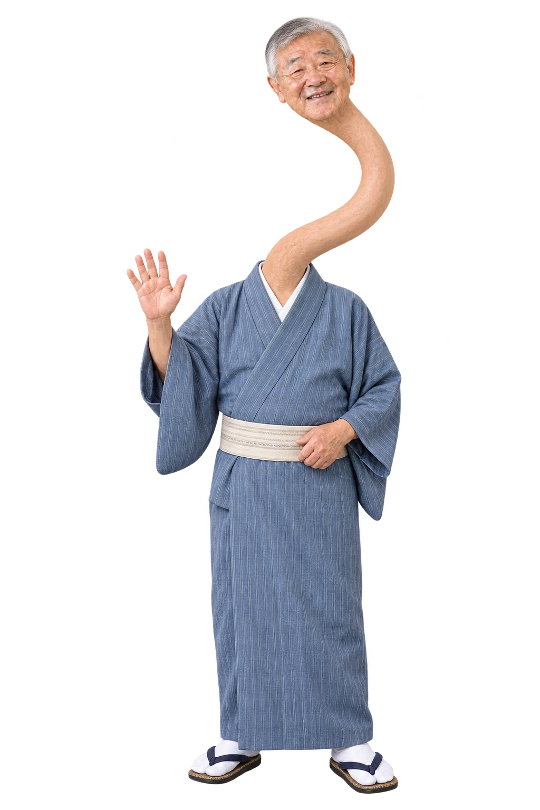

# ろくろ首の幸造さん

「ろくろ首・首がにゅーっとごあいさつ」をハロウィンに1種類追加しました。いつもの幸造さんの顔・笑顔を保ち、青い着物から長い首がS字に伸びて手を振る全身の透過素材です。「ろくろ首」「ろくろくび」「ロクロクビ」で検索できます。ハロウィンは25種類、全体は552種類・22ジャンルです。 以前の551種類はすべて残しています。

内蔵画像生成ツールで assets/003.png を人物参照として作成しました。[全生成条件](rokurokubi-prompt.json)を保存しています。透過PNG原本はローカル作業フォルダー output/rokurokubi/halloween-rokurokubi.png、公開用は assets/library/halloween-rokurokubi.webp、一覧用は assets/thumbnails/halloween-rokurokubi.webp、単体HTML用は assets/offline/halloween-rokurokubi.webp です。
